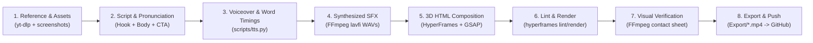

# Viral Video Engine — End-to-End Workflow Guide

This document describes the complete pipeline used in `video viral/` to plan, script, voice, animate, verify, and publish vertical (`1080×1920`, `30 fps`) 3D motion-graphics reels and video edits using **HyperFrames**, **Edge TTS**, **FFmpeg**, and **yt-dlp**.

---

## 1. Architecture & Pipeline Overview



---

## 2. Directory Structure

```text
video viral/
├── WORKFLOW.md                        # This workflow guide
├── Raw footage/                       # Incoming raw clips (e.g. VID-20261112-WA0011.mp4)
├── Style Reference/                   # Downloaded reference reels for pacing/color analysis
├── Export/                            # Final rendered 1080x1920 MP4 deliverables
│   ├── antigravity-student-offer-3d.mp4
│   ├── tv-box-botnet-edit.mp4
│   ├── aayojon-part1-sami-3d.mp4
│   └── making-of-video-engine-3d.mp4
└── engine/                            # HyperFrames project root
    ├── .nvmrc                         # Node.js 22 requirement
    ├── .venv/                         # Python venv (edge-tts, yt-dlp)
    ├── package.json                   # hyperframes dependency & npm scripts
    ├── scripts/
    │   └── tts.py                     # Edge TTS generator + WordBoundary JSON exporter
    ├── assets/
    │   ├── aayojon/                   # Staged product screenshots & logo (PNG)
    │   ├── audio/                     # Generated .mp3 voiceovers + .timestamps.json
    │   ├── sfx/                       # Synthesized .wav effects (whoosh, pop, alert, chime)
    │   └── video/                     # Staged video clips for edit compositions
    ├── index.html                     # Antigravity Student Offer 3D reel
    ├── edit-wa0011.html               # TV Box Botnet edit composition
    ├── aayojon-part1.html             # Aayojon Part 1 (Sami character) 3D reel
    └── making-of.html                 # Behind-the-scenes 3D reel
```

---

## 3. Tool Stack & Environment

| Tool | Version / Path | Role |
| :--- | :--- | :--- |
| **Node.js** | `v22.23.5` (`~/.nvm/versions/node/v22.23.5/bin`) | Required (`>=22`) by HyperFrames CLI |
| **HyperFrames** | `0.9.40` (`engine/node_modules/.bin/hyperframes`) | HTML/CSS/GSAP 3D timeline compiler, linter, and headless Chrome renderer |
| **FFmpeg / FFprobe** | `9.0.2` (`/opt/homebrew/bin/ffmpeg`) | Audio/video probing, SFX synthesis, and verification contact sheets |
| **edge-tts** | `7.3.1` (`engine/.venv/bin/python`) | Neural TTS synthesis + `WordBoundary` millisecond timestamps |
| **yt-dlp** | `2026.10.26` (`engine/.venv/bin/yt-dlp`) | Downloading reference reels and raw footage |
| **Google Chrome** | `/Applications/Google Chrome.app/Contents/MacOS/Google Chrome` | Capture browser used by `hyperframes render` |

Always ensure Node 22 and Homebrew FFmpeg are on `PATH` before running HyperFrames:

```bash
export PATH="$HOME/.nvm/versions/node/v22.23.5/bin:/opt/homebrew/bin:$PATH"
```

---

## 4. Step-by-Step Workflow

### Step 1 — Gather Style References & Visual Assets
1. **Download style references** into `Style Reference/`:
   ```bash
   cd "video viral/engine"
   npm run download:style -- "<REEL_URL>"
   ```
2. **Analyze pacing & visual tone** with `ffprobe` / `ffmpeg` (scene cuts, luma, warmth/saturation, aspect ratio) so the composition matches the target aesthetic (e.g., bright warm-off-white `#F7F5F0` canvas, crisp typography, fast scene cadence).
3. **Stage local assets** into `engine/assets/<project>/` (screenshots, logos, or clips) so all paths in the HTML composition are relative (`assets/...`).

---

### Step 2 — Write the Script & Phonetic Hints
Structure short-form scripts (`35s–50s`) into 4–5 beats:
1. **Hook (`0–4s`)**: Immediate value proposition or curiosity gap.
2. **Context / Problem (`4–15s`)**: Why it matters or how it started.
3. **Solution / Demo (`15–32s`)**: Concrete visuals, real screenshots, or character presentation.
4. **CTA (`32–40s+`)**: Single clear keyword comment prompt (e.g., `Comment "ENGINE"`).

> [!TIP]
> **Phonetic Spelling for TTS vs. On-Screen Captions:**
> When a neural voice mispronounces proper nouns or Bengali words, pass phonetic spellings to `tts.py` (e.g., `"Shaami"` for **Sami (ছামি)**, `"Ayo-jone"` for **Aayojon**), then map the `word` field in the generated `.timestamps.json` back to the clean display spelling before injecting into HTML captions.

---

### Step 3 — Generate Voiceover & Word-Level Timings
Run `engine/scripts/tts.py` from `video viral/engine`:

```bash
.venv/bin/python scripts/tts.py \
  "Your script text here..." \
  --voice en-US-BrianMultilingualNeural \
  --rate "+14%" \
  --pitch "+6Hz" \
  --out my_video
```

What `tts.py` produces in `engine/assets/audio/`:
- `my_video.mp3` — Synthesized voiceover audio.
- `my_video.timestamps.json` — Array of `{ "word", "start", "end" }` objects derived from Edge TTS `WordBoundary` events (`100ns` ticks converted to seconds).

Check exact audio duration with `ffprobe` before locking the HTML composition duration:

```bash
ffprobe -v error -show_entries format=duration -of default=noprint_wrappers=1:nokey=1 assets/audio/my_video.mp3
```

---

### Step 4 — Synthesize Sound Effects (SFX)
Procedural WAV effects in `engine/assets/sfx/` are generated with FFmpeg `lavfi` sources (`whoosh.wav`, `pop.wav`, `alert.wav`, `chime.wav`). They can be placed on exact timeline timestamps in the HTML using `<audio>` tags:

```html
<audio id="vo" src="assets/audio/my_video.mp3" data-start="0.15" volume="1.0"></audio>
<audio id="sfx-pop-1" src="assets/sfx/pop.wav" data-start="3.89" volume="0.35"></audio>
<audio id="sfx-whoosh-1" src="assets/sfx/whoosh.wav" data-start="13.52" volume="0.30"></audio>
<audio id="sfx-chime-end" src="assets/sfx/chime.wav" data-start="36.36" volume="0.35"></audio>
```

> [!IMPORTANT]
> Every `<audio>` or `<video>` element with `data-start` **must** have a unique `id` attribute, or `hyperframes lint` will fail.

---

### Step 5 — Author the HyperFrames 3D Composition
Create a self-contained HTML file in `video viral/engine/` (e.g., `making-of.html`):
- **Root composition attributes:**
  ```html
  <div id="root"
       data-composition-id="making-of"
       data-width="1080"
       data-height="1920"
       data-fps="30"
       data-duration="40">
  ```
- **3D Scene Architecture:** Use CSS `perspective` + `transform-style: preserve-3d` paired with GSAP timelines synced to HyperFrames' deterministic frame clock (`window.__hf` / `data-start`).
- **Fonts:** `Inter` and `JetBrains Mono` resolve deterministically via HyperFrames' Google Fonts compiler cache without font warnings.
- **Word-Level Captions:** Inject the formatted `WORDS` array (with `word`, `start`, `end`, and optional `accent: true` highlight flags) directly into the composition `<script>`, grouping words into 6–7 word chunks for readable top/bottom captions.

---

### Step 6 — Lint & Render to MP4
1. **Lint first** (catches missing IDs, broken asset paths, invalid attributes):
   ```bash
   cd "video viral/engine"
   export PATH="$HOME/.nvm/versions/node/v22.23.5/bin:/opt/homebrew/bin:$PATH"
   ./node_modules/.bin/hyperframes lint making-of.html
   ```
2. **Render to `Export/`** (requires full network/localhost Chrome access):
   ```bash
   export HYPERFRAMES_BROWSER_PATH="/Applications/Google Chrome.app/Contents/MacOS/Google Chrome"
   ./node_modules/.bin/hyperframes render -c making-of.html --output "../Export/making-of-video-engine-3d.mp4"
   ```

---

### Step 7 — Visual Verification
Before considering a render complete, generate a 5-frame contact sheet across the full duration and inspect it visually:

```bash
ffmpeg -y -i "video viral/Export/making-of-video-engine-3d.mp4" \
  -vf "fps=1/8,scale=270:480,tile=5x1" -frames:v 1 \
  /tmp/verify_contact_sheet.jpg
```

Verify:
- Captions are legible, properly highlighted, and never overlap 3D cards.
- Product screenshots and custom SVG/CSS characters render cleanly.
- Every scene transition lands cleanly within the `40.0s` / `50.4s` window.

---

## 5. Publishing to GitHub
Rendered MP4 deliverables in `Export/` are published to `CARE-Conflict-free-AI-Routine-Engine.git` (`main` branch) via an isolated shallow clone so the local `ayojon` repository stays clean:

```bash
rm -rf /tmp/care-video-push
git clone --depth 1 https://github.com/sameul-hasan/CARE-Conflict-free-AI-Routine-Engine.git /tmp/care-video-push
cp "video viral/Export/making-of-video-engine-3d.mp4" /tmp/care-video-push/
git -C /tmp/care-video-push add making-of-video-engine-3d.mp4
git -C /tmp/care-video-push commit -m "Add making-of-video-engine-3d.mp4"
git -C /tmp/care-video-push push origin main
rm -rf /tmp/care-video-push
```

---

## 6. Deliverables Produced with This Workflow

| Deliverable | Duration | Size | Key Features |
| :--- | :--- | :--- | :--- |
| `antigravity-student-offer-3d.mp4` | `38.0s` | `5.9 MB` | 3D motion-graphics explainer + synced captions |
| `tv-box-botnet-edit.mp4` | `26.1s` | `28.8 MB` | Raw footage edit (`VID-20261112-WA0011.mp4`) + HUD overlays + SFX |
| `aayojon-part1-sami-3d.mp4` | `50.4s` | `13.4 MB` | Animated host **Sami (ছামি)** + real Aayojon screenshots + playful TTS |
| `making-of-video-engine-3d.mp4` | `40.0s` | `4.0 MB` | 5-scene behind-the-scenes breakdown of the engine itself |
